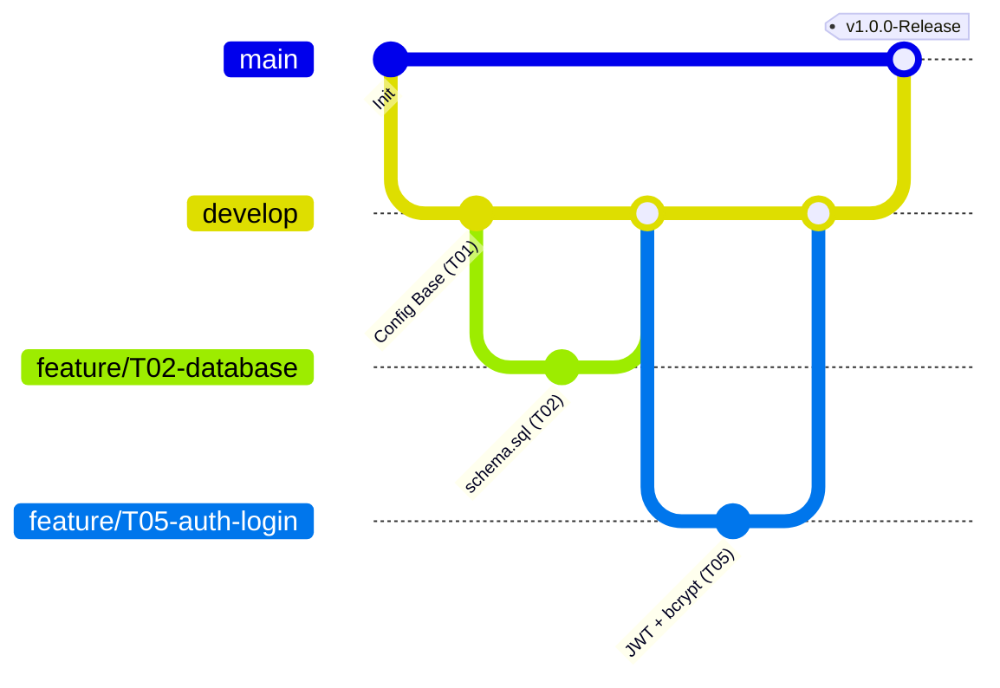

# 📜 Cláusulas de Desarrollo, Flujo Git y Estándar de Código — InfoFIX

**Equipo:** InfoPapus  
**Proyecto:** InfoFIX (Trazabilidad, Órdenes de Servicio y Certificación QR)  
**Materia:** Ingeniería de Software — CUCEI, Universidad de Guadalajara  
**Líder de Proyecto / DevOps:** Leonardo Atos Aguilar Nuñez  

---

## 🎯 1. Principio Fundamental y Regla Contractual
Este proyecto se construye y evalúa bajo un contrato formal de requerimientos basado en el estándar **ANSI/IEEE 830-1998**.

1. **Cero Desvío de Alcance (*No Scope Creep*):** No implementar pasarelas de pago bancarias, inventarios de almacén o facturación. Nos ceñimos a los 15 Requisitos Funcionales (`RF-01` a `RF-15`).
2. **Inmutabilidad de Reglas de Negocio:** La máquina de estados es estrictamente secuencial:  
   `Recibido` ➔ `Diagnóstico` ➔ `Reparación` ➔ `Pruebas` ➔ `Entregado`.  
   Toda transición exige una nota técnica obligatoria $\ge 5$ caracteres.
3. **Privacidad y Evidencias:** Máximo 5 fotografías en recepción ("antes") y 5 fotografías en entrega ("después"), máx 5 MB cada una (JPG/PNG). La vista pública enmascara el IMEI (`***********1234`) y protege los datos del cliente.

---

## 🌿 2. Estrategia de Ramas en Git

Para evitar conflictos y pérdidas de código, **queda estrictamente prohibido hacer commits directos en la rama `main`**.



### 2.1. Tipos de Ramas
* **`main` (Producción / Entregas Académicas):** Contiene código estable, validado y listo para evaluación y demostración ante la profesora. Solo recibe fusiones (*merges*) desde `develop`.
* **`develop` (Integración Central):** Rama común donde confluyen todos los avances del equipo. Todo trabajo parte de `develop` y regresa a `develop`.
* **Ramas de Tareas / Features:**
  * Formato: `feature/T<numero>-<nombre-corto>`
  * Ejemplos:  
    * `feature/T02-diseno-base-datos`
    * `feature/T04-servidor-express`
    * `feature/T05-login-jwt`
    * `feature/T11-vistas-clientes-celulares`
* **Ramas de Corrección (Hotfix / Bugfix):**
  * Formato: `fix/T<numero>-<problema>`
  * Ejemplo: `fix/T03-correccion-constraint-imei`

### 2.2. Flujo de Trabajo Diario para Cada Integrante

1. **Actualizar tu entorno local:**
   ```bash
   git checkout develop
   git pull origin develop
   ```
2. **Crear tu rama de trabajo:**
   ```bash
   git checkout -b feature/T05-login-jwt
   ```
3. **Desarrollar y documentar:** Seguir el estándar de código (Sección 3).
4. **Hacer commits claros y frecuentes:**
   ```bash
   git add .
   git commit -m "feat(auth): implementar controlador de login con bcrypt (T05)"
   ```
5. **Subir tu rama a GitHub:**
   ```bash
   git push -u origin feature/T05-login-jwt
   ```
6. **Abrir Pull Request (PR) hacia `develop`:** Rellenar la plantilla obligatoria con la checklist de pruebas.

---

## 📝 3. Estándar de Documentación de Código (Heredado de DD)

Todo archivo y función nueva debe cumplir con este estándar para mantener la legibilidad y evitar confusión entre los módulos.

### 3.1. Cabecera Obligatoria de Archivo
Al inicio de cada archivo JavaScript, SQL o script, coloca un bloque de comentario describiendo el módulo:

```javascript
/**
 * @file auth.controller.js
 * @description Controlador de autenticación del personal del taller (Login y emisión de JWT).
 * @module controllers/auth
 * @project InfoFIX - InfoPapus (CUCEI)
 * @task T05 (RF-01)
 * @author María Fernanda González Rodríguez
 */
```

### 3.2. JSDoc Obligatorio en Cada Función
Debajo de la declaración de cada función (`function` o `const funcion = (...) =>`), documenta con:
* **Descripción:** Propósito claro de la función.
* **`@param` / Args:** Tipo de dato, nombre y explicación de cada argumento.
* **`@returns` / Returns:** Tipo de dato retornado y qué información contiene.
* **`@throws` / Raises:** Errores esperados o excepciones arrojadas.

**Ejemplo en JavaScript:**
```javascript
/**
 * Valida las credenciales del técnico y genera un token JWT con vigencia de 8 horas.
 * 
 * @param {string} email - Correo electrónico institucional del técnico.
 * @param {string} password - Contraseña en texto plano para cotejar con hash.
 * @returns {Promise<{token: string, usuario: {id: number, nombre: string, rol: string}}>} Objeto con token JWT y datos seguros.
 * @throws {Error} Lanza error 401 si las credenciales son inválidas o 500 ante fallas de base de datos.
 */
async function autenticarUsuario(email, password) {
  // 1. Buscar usuario por email en la base de datos
  // 2. Comparar password con bcrypt.compare(password, hash)
  // 3. Firmar payload con jwt.sign(..., secret, { expiresIn: '8h' })
}
```

### 3.3. Comentarios Internos Limpios
* **Prohibido comentar lo obvio:** (Ej. `// suma 1 a la variable i`).
* **Uso exclusivo para decisiones técnicas y reglas de negocio complejas:**
  * Explicar transacciones ACID (`BEGIN TRANSACTION`, `COMMIT`, `ROLLBACK`).
  * Enmascaramiento de IMEI para privacidad (`imei.slice(-4)`).
  * Validaciones de buffer binario o tipos MIME en Multer.
  * Lógica de cálculo de fecha de garantía (`dias_garantia`).

---

## 💬 4. Convención de Mensajes de Commit

Cada commit debe describir con exactitud qué se cambió y ligarlo a su tarea WBS si corresponde:

* **Estructura:**  
  `<tipo>(<módulo>): <descripción concisa en imperativo> (T<ID>)`

* **Tipos permitidos:**
  * `feat`: Nueva funcionalidad (ej. `feat(qr): generar código QR con UUID v4 (T21)`).
  * `fix`: Corrección de bug o fallo (ej. `fix(db): corregir llave foranea en tabla ordenes (T03)`).
  * `docs`: Cambios en documentación o README (ej. `docs: actualizar clausulas de desarrollo y variables .env`).
  * `refactor`: Reestructuración de código sin alterar comportamiento.
  * `test`: Casos de prueba unitarios o de integración (ej. `test(auth): agregar prueba de credenciales erroneas (T08)`).
  * `chore`: Mantenimiento de paquetes, gitignore o configuración base.

---

## 👥 5. Matriz de Responsabilidades y Asignación WBS

| Integrante | Rol Oficial | Tareas Asignadas | Módulos Clave |
| :--- | :--- | :--- | :--- |
| **Leonardo Atos Aguilar Nuñez** | Project Manager / DevOps / Integración | T01, T26, T28 | GitHub, Ramas, PRs, Red de Demostración LAN/ngrok, Auditoría |
| **Mauricio Razón Ramos** | Arquitecto de Base de Datos y QA | T02, T03 | Diagrama DER, `database/schema.sql`, `seed.sql`, Integridad referencial |
| **María Fernanda González Rodríguez** | Lead Backend & Seguridad | T04, T05, T09, T10, T12, T13, T15, T16, T17, T20, T21, T23 | API Express, JWT, Multer, QR, UUID v4, CRUDs, Garantías |
| **Yahúm Adair Hernández Martínez** | Lead Frontend & UI/UX | T06, T07, T11, T14, T18, T22, T24, T25 | Vistas SPA, Login UI, Dashboard, Timeline, Certificado Imprimible, Portal QR |
| **Marco Yahir Guzmán Gasca** | Lead QA & Testing Orientado a Fallos | T08, T19, T27 | Testing ERS, inyecciones inválidas, validación de estados y límites |

---

*Cualquier duda o ajuste a este estándar debe consultarse con Leonardo Atos Aguilar Nuñez (Líder DevOps).*
